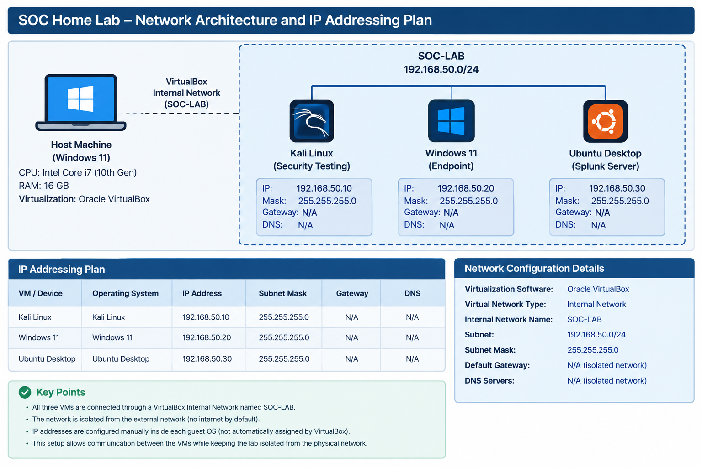
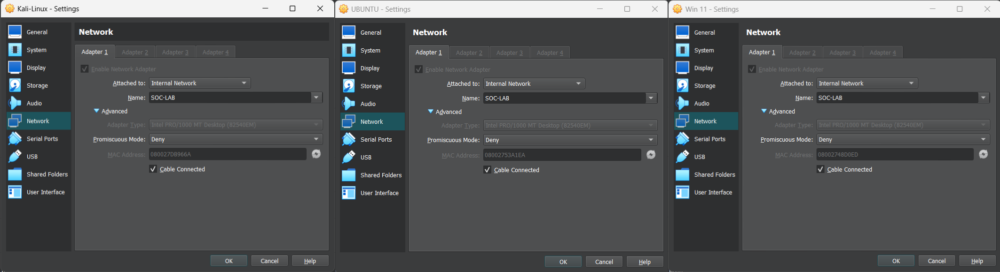
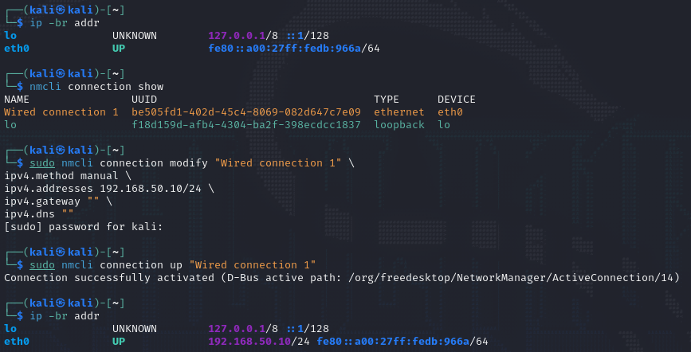
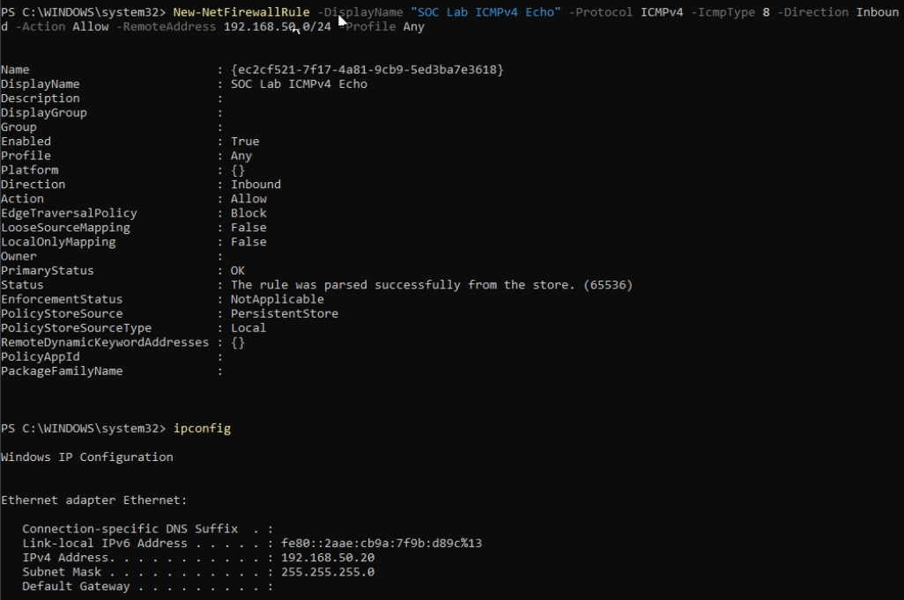
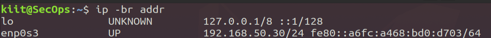
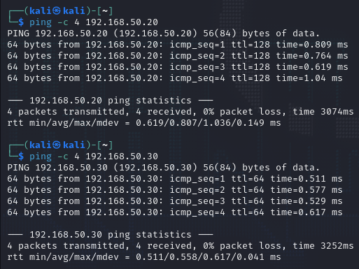
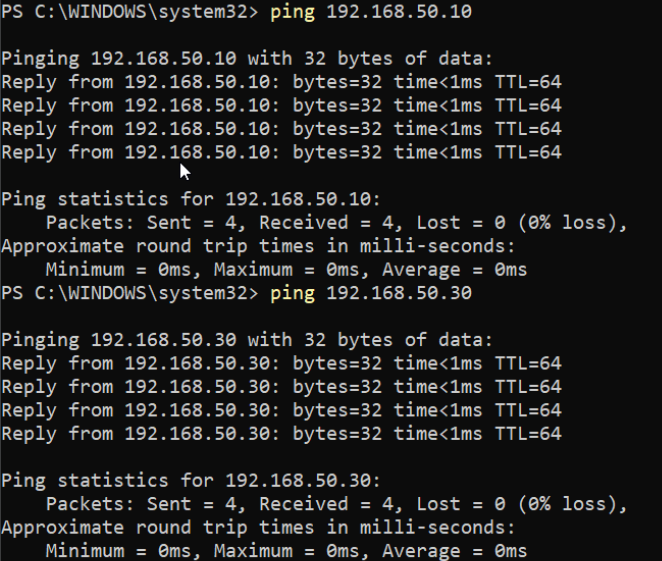
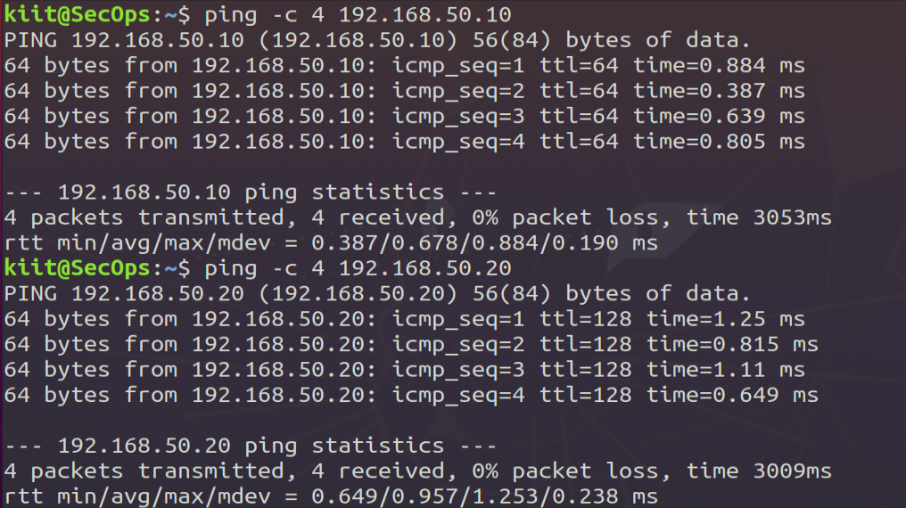

# Phase 1 — Lab Setup and Network Configuration

## 1. Overview

The first phase of the Splunk SOC Home Lab focused on building and validating an isolated virtual environment for security monitoring, Windows event collection, detection engineering, and incident investigation.

The lab uses Oracle VirtualBox to run three virtual machines on a dedicated internal network. Each machine has a defined role and static IP address within the lab subnet.

All Phase 1 setup and network validation tasks have been completed successfully.

### Objectives

* Prepare the virtual machines required for the SOC lab.
* Establish an isolated VirtualBox internal network.
* Configure IP addressing for each virtual machine.
* Verify network adapter settings and IP configurations.
* Test connectivity between the lab machines.
* Document the architecture, configuration, validation results, and security considerations.

## 2. Lab Environment

The lab runs on a Windows 11 host using Oracle VirtualBox.

| Component                  | Configuration                  |
| -------------------------- | ------------------------------ |
| Host operating system      | Windows 11                     |
| Virtualization platform    | Oracle VirtualBox              |
| Host processor             | Intel Core i7, 10th generation |
| Host memory                | 16 GB RAM                      |
| Number of virtual machines | 3                              |
| Network type               | VirtualBox Internal Network    |
| Internal network name      | `SOC-LAB`                      |
| Network subnet             | `192.168.50.0/24`              |

### Virtual Machines

| Virtual machine | Role                                                 | IP address         |
| --------------- | ---------------------------------------------------- | ------------------ |
| Kali Linux      | Controlled security testing and adversary simulation | `192.168.50.10/24` |
| Windows 11      | Endpoint and source of Windows security telemetry    | `192.168.50.20/24` |
| Ubuntu Desktop  | Host for the planned Splunk Enterprise installation  | `192.168.50.30/24` |

The Ubuntu machine is designated as the Splunk host for the next phase. Splunk installation and log forwarding are outside the scope of Phase 1.

## 3. Lab Architecture

The lab uses a dedicated VirtualBox Internal Network named `SOC-LAB`. This allows the virtual machines to communicate over the lab network without requiring their lab adapters to be bridged directly onto the physical network.

The network uses the private IPv4 subnet `192.168.50.0/24`, with each virtual machine assigned a unique static IP address.

### Network Architecture Diagram

<!-- Screenshot 1: Insert a clear network architecture diagram showing the Windows 11 host, VirtualBox, the SOC-LAB internal network (192.168.50.0/24), and the three VMs with their roles and IP addresses. Clearly distinguish the host from the virtual machines. -->

*Figure 1: SOC Home Lab network architecture and IP addressing plan.*

### Network Design

* **Kali Linux:** Used for controlled security testing within the lab.
* **Windows 11:** Acts as the endpoint whose security events will later be collected and analyzed.
* **Ubuntu Desktop:** Reserved for Splunk Enterprise and centralized log analysis.
* **SOC-LAB:** Provides the private communication network connecting the lab machines.

The network design separates the lab environment from the host's normal network connection. Bridged networking is not used for the lab network.

## 4. VirtualBox Network Configuration

The virtual machines were configured to use the VirtualBox Internal Network named `SOC-LAB` for lab communication.

## Steps to change the settings
1) Open Oracle VirtualBox Manager.
2) Select the Kali Linux virtual machine.
3) Click Settings → Network.
4) Under Adapter 1, enable the network adapter.
5) Set Attached to to Internal Network.
5) Enter SOC-LAB as the network name.
6) Click OK to save the settings.

## Repeat the same steps for Ubuntu and Windows 11

### Network Adapter

<!-- Screenshot 2: Insert a screenshot of VirtualBox Manager → Kali Linux → Settings → Network → Adapter 1. Show that the adapter is enabled, Attached to is Internal Network, and the network name is SOC-LAB. -->

*Figure 2: Network adapter configuration.*

Using the same internal network name on the lab adapters places the virtual machines on the same VirtualBox internal network. The IP address configuration inside each guest determines how they communicate over IPv4.

## 5. IP Addressing Configuration

Each virtual machine was assigned a static IP address in the `192.168.50.0/24` subnet.

The `/24` prefix corresponds to the subnet mask `255.255.255.0`. The addresses are unique within the lab subnet.

| Virtual machine | IP address      | Subnet mask     | Purpose            |
| --------------- | --------------- | --------------- | ------------------ |
| Kali Linux      | `192.168.50.10` | `255.255.255.0` | Security testing   |
| Windows 11      | `192.168.50.20` | `255.255.255.0` | Endpoint telemetry |
| Ubuntu Desktop  | `192.168.50.30` | `255.255.255.0` | Planned SIEM host  |

No default gateway or DNS server is required on the isolated lab interface for communication between these machines on the same subnet. Internet access, if needed for downloads, should be handled separately and deliberately.

### Kali Linux IP Configuration

<!-- Screenshot 5: Insert terminal output from Kali showing the actual IP address and subnet mask of the SOC-LAB interface. For example, use `ip -br addr` or `ip addr`. Make sure the relevant interface and 192.168.50.10/24 address are readable. -->

*Figure 5: Kali Linux lab IP address.*

### Windows 11 IP Configuration

<!-- Screenshot 6: Insert Windows terminal output from `ipconfig` showing the relevant network adapter, IPv4 address 192.168.50.20, and subnet mask 255.255.255.0. -->

*Figure 6: Windows 11 lab IP address.*

### Ubuntu Desktop IP Configuration

<!-- Screenshot 7: Insert terminal output from Ubuntu showing the actual lab interface and 192.168.50.30/24 address. For example, use `ip -br addr` or `ip addr`. -->

*Figure 7: Ubuntu Desktop lab IP address.*

## 6. Network Connectivity Validation

Network connectivity was tested to confirm that the virtual machines can communicate over the intended lab network.

The `ping` command was used to test IP-level reachability between the lab machines. A successful response indicates that ICMP echo traffic reached the target and an echo reply was received. A failed response alone does not prove that two machines cannot communicate, because firewall rules may block ICMP.

### Connectivity Test Matrix

| Source         | Destination                  | Expected result |
| -------------- | ---------------------------- | --------------- |
| Kali Linux     | Windows 11 (`192.168.50.20`) | Reachable       |
| Kali Linux     | Ubuntu (`192.168.50.30`)     | Reachable       |
| Windows 11     | Kali Linux (`192.168.50.10`) | Reachable       |
| Windows 11     | Ubuntu (`192.168.50.30`)     | Reachable       |
| Ubuntu Desktop | Kali Linux (`192.168.50.10`) | Reachable       |
| Ubuntu Desktop | Windows 11 (`192.168.50.20`) | Reachable       |

The tests above represent the intended validation matrix. The screenshots below should show the actual commands and successful results from your lab.

### Connectivity Test Evidence

<!-- Screenshot 8: Insert a screenshot from Kali showing successful ping replies from Windows 11 and Ubuntu. Include the commands and enough output to demonstrate successful replies. -->

*Figure 8: Connectivity tests initiated from Kali Linux.*

<!-- Screenshot 9: Insert a screenshot from Windows showing successful ping replies from Kali and Ubuntu. Use `ping 192.168.50.10` and `ping 192.168.50.30`. -->

*Figure 9: Connectivity tests initiated from Windows 11.*

<!-- Screenshot 10: Insert a screenshot from Ubuntu showing successful ping replies from Kali and Windows. Use `ping 192.168.50.10` and `ping 192.168.50.20`. -->

*Figure 10: Connectivity tests initiated from Ubuntu Desktop.*

### Validation Outcome

The lab network configuration and connectivity tests were completed successfully. The three virtual machines are configured for communication over the `SOC-LAB` network, providing the network foundation required for the subsequent Splunk installation and telemetry collection phases.

## 7. Security Considerations

The lab was designed with isolation and controlled testing in mind.

* **Network isolation:** VirtualBox Internal Network is used for the lab adapters.
* **No bridged lab adapter:** The lab machines are not directly bridged onto the physical LAN through their lab interfaces.
* **Controlled testing:** Security testing is restricted to authorized systems within the lab.
* **Limited exposure:** Splunk services should not be exposed directly to the public internet in subsequent phases.
* **Resource management:** Only the virtual machines needed for a task should be running when practical, given the host's 16 GB of RAM.
* **Configuration hygiene:** Temporary network changes should be reviewed and reverted when no longer needed.

An Internal Network isolates communication through that particular VirtualBox network; it does not automatically guarantee that a VM has no other network adapters or routes. Any additional adapters should be reviewed separately.

## 8. Troubleshooting Notes

The following checks are useful if network connectivity breaks in the future:

1. Confirm that both machines are attached to the same Internal Network name: `SOC-LAB`.
2. Check that each machine has the intended IP address and subnet mask.
3. Verify that the IP addresses are unique.
4. Check the guest operating system's firewall if ICMP traffic is blocked.
5. Confirm that the correct network interface is active.
6. Check for unexpected additional adapters, routes, or conflicting IP addresses.

These checks help distinguish VirtualBox adapter configuration problems from guest operating system network or firewall issues.

## 9. Phase 1 Deliverables

The completed phase establishes the following foundation for the SOC Home Lab:

* Three virtual machines prepared for their designated roles.
* A dedicated VirtualBox Internal Network named `SOC-LAB`.
* A defined private IPv4 subnet and IP addressing scheme.
* Verified network adapter and guest IP configurations.
* Completed connectivity tests between the lab machines.
* Documented architecture, evidence, and security considerations.

## 10. Conclusion

Phase 1 established the virtual lab environment and validated its network configuration. Kali Linux, Windows 11, and Ubuntu Desktop are connected through the intended `SOC-LAB` network using the planned private IP addressing scheme.

This provides the foundation for Phase 2, which will focus on installing Splunk Enterprise on the designated Ubuntu host and verifying that the SIEM service is operational.

## 11. References

* [Oracle VirtualBox Documentation](https://www.virtualbox.org/manual/)
* [VirtualBox Networking Documentation](https://www.virtualbox.org/manual/ch06.html)
* [Kali Linux — Official Downloads](https://www.kali.org/get-kali/)
* [Windows 11 — Official Download](https://www.microsoft.com/software-download/windows11)
* [Ubuntu Desktop — Official Download](https://ubuntu.com/download/desktop)
* [Splunk Enterprise — Official Download](https://www.splunk.com/en_us/download/splunk-enterprise.html)
* [Splunk Documentation](https://docs.splunk.com/Documentation)

---

**Next phase:** [Phase 2 — Splunk Installation](../Phase-2-Splunk-Installation/README.md)
